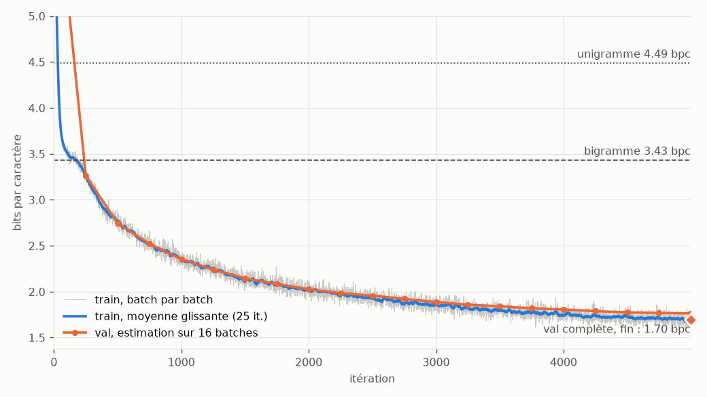

# nanogpt-numpy

Un petit GPT au niveau caractère, écrit en NumPy et rien d'autre, sans
PyTorch ni différentiation automatique. Chaque couche a sa passe avant et sa
rétropropagation écrites à la main, et chaque gradient est vérifié par
différences finies. Le modèle s'entraîne sur le texte des *Misérables* de
Victor Hugo : 5 000 itérations sur deux cœurs de CPU, en 81 minutes pour le
run publié.

Code : https://github.com/pinpin-http/nanogpt-numpy



## Pourquoi

Avec un framework, `loss.backward()` fait tout le travail et on finit par
oublier ce qu'il calcule. Ici, il faut dériver soi-même une LayerNorm, un
softmax masqué ou une attention multi-têtes, puis le prouver avec un test. Le
modèle reste assez petit pour tourner sur un portable, mais il contient toutes
les pièces d'un transformer décodeur.

## Résultats

Mesures sur toute la validation, soit 308 927 caractères à prédire, chacun
compté une fois :

| | nats / caractère | bits / caractère |
|---|---:|---:|
| Unigramme (fréquence de chaque caractère) | 3,111 | 4,488 |
| Bigramme (d'après le caractère précédent) | 2,379 | 3,432 |
| nanogpt-numpy (823 296 paramètres) | 1,177 | 1,698 |

Le modèle a besoin de 1,70 bit par caractère, contre 3,43 pour le bigramme,
soit 51 % de moins. Il est évalué par fenêtres glissantes de 128 caractères
avec un pas de 64 : hormis le tout début, chaque caractère a au moins 64
caractères de contexte derrière lui. Les baselines utilisent un lissage additif dont le
coefficient est choisi pour minimiser leur loss sur la validation elle-même,
ce qui les avantage.

Conditions du run publié (`docs/results.json`) : 4 couches, 4 têtes,
dimension 128, contexte de 128 caractères, batchs de 32 séquences, poids de
sortie liés aux embeddings. 5 000 itérations pilotées par le nombre de pas,
sans budget de temps, graine 1337, 2 threads (`OMP_NUM_THREADS`,
`OPENBLAS_NUM_THREADS` et `MKL_NUM_THREADS` à 2). Le run a duré 80,7 minutes,
soit 0,97 s par pas évaluations comprises, pour 20,5 millions de caractères
vus : environ 7,4 passes sur le texte d'entraînement. La machine, un Ryzen 5
5600G (6 cœurs, 12 threads), était partagée : trois entraînements de réseaux
de graphes sur 2 threads chacun, un quatrième sur le GPU, un émulateur
Android et Gradle tournaient en même temps. La vitesse a varié en cours de
route : 1,2 s par pas sur les 250 premières itérations, 0,86 s sur les 1 000
dernières.

Sur la courbe, la loss d'entraînement marque un palier vers 3,45 bits par
caractère, au niveau du bigramme, entre les itérations 110 et 200 environ,
puis repart à la baisse. La descente ralentit ensuite sans nouveau palier :
l'estimation de validation gagne 0,33 bit par caractère entre les itérations
1 000 et 2 000, 0,14 entre 2 000 et 3 000, 0,08 entre 3 000 et 4 000, puis
0,04 sur les 1 000 derniers pas, pendant lesquels le taux d'apprentissage
finit sa décroissance vers 2e-4. Jusqu'à l'itération 2 250, la loss de
validation estimée reste un peu sous celle d'entraînement ; les deux se
croisent vers 2 500, puis l'écart se creuse lentement. À la dernière
estimation, la validation (1,223 nats) dépasse l'entraînement (1,195) de
0,028 nats, soit 0,04 bit par caractère. L'évaluation complète (le losange,
1,70 bit) est plus basse que cette estimation sur 16 batches : elle donne à
chaque caractère au moins 64 caractères de contexte, alors que les batches
tirés au hasard comptent aussi les premières positions de chaque fenêtre.

Le run publié auparavant s'était arrêté à 796 pas, au bout d'un budget de 25
minutes sur une machine chargée, à 2,45 bits par caractère. Le nouveau run,
à graine égale, gagne 0,75 bit par caractère.

Génération de 300 caractères, même graine, mesurée par `make report` sur la
même machine, alors peu chargée (charge moyenne de 1,7 sur une minute) :
1 489 caractères par seconde avec le cache KV, 192 sans, soit 7,7 fois plus
vite.

### Échantillons

Température 0,8, top-k 20, graines 1 à 3, 400 caractères générés après
l'amorce, sans retouche (`docs/samples.json`) :

```text
Javert regarda vers la boue.
--J'ai là.
--Comment.
--Alors, il trouva les fautes et des martruisements de l'apitlé, repos à l'autre le soleil de la rue. L'homme s'attaqua dans le dix voir de longtempsion que Jean Valjean fut vivement donné dans la voix:
--Ce monsieur a ainsi.
--Basse devait cela.
--Quel abîme s'agit et le jour toujours d'un air de passer de la rue de la Braverne.
--On me voudrait de cette fois 
```

```text
La nuit était découvert.
En même temps, mais on ne savait pas au soir, elle a un moment du plaisir avait fait ailleurs.
Chapitre V
Un grand momins qui par un fouissement de sa hauteur de terre. Quant aucun cet homme fil pour moi tranquille. Elle a redoute passa dans la redingote, la grosse de pavés outils de cordes sur la rue et les dents, non lui qui s'en fallu de la marche et sa terre, et que sa pente violée
```

```text
--Monsieur, dit Jean Valjean. Une façon est un prison.
Le reste est frappé de la santé; l'effet de toute la porte de ma maladie et le révolution de ces cents du champ. Il était devenu tout mille en toucher, qui se précipitait une connaissance de sa cour le long et de la charte de la mort, il y avait un monde, mais elle s'aperceva à partir et se dressa que j'ai des batterres. Il est toujours s'asseoir, il a propr
```

Au bout de 5 000 pas, la plupart des mots sont de vrais mots français, longs
compris (« précipitait », « connaissance », « redingote », « tranquille »).
Le modèle reprend aussi la mise en forme du roman : répliques ouvertes par
« -- » en début de ligne, titre « Chapitre V » seul sur sa ligne, nom de Jean
Valjean placé après « dit ». Il invente encore des mots (« martruisements »,
« longtempsion », « batterres ») et des conjugaisons (« s'aperceva »), et se
trompe sur les accords et les genres (« La nuit était découvert », « un
prison », « le révolution »). Le sens ne tient que sur quelques mots : « Le
reste est frappé de la santé » est une phrase bien construite qui ne veut
rien dire, et les répliques (« --J'ai là. », « --Comment. ») ne se répondent
pas.

## Comment c'est construit

| Fichier | Contenu |
|---|---|
| `nanogpt/layers.py` | Linear, Embedding, LayerNorm, GELU, attention causale multi-têtes, MLP, bloc, softmax + entropie croisée |
| `nanogpt/model.py` | GPT : embeddings de caractères et de positions, blocs, tête de sortie liée aux embeddings, cache KV, sauvegarde |
| `nanogpt/optim.py` | AdamW, warmup puis cosinus, écrêtage de la norme globale du gradient |
| `nanogpt/data.py` | téléchargement Gutenberg, nettoyage, tokenizer caractère, découpage train/val, tirage des batches |
| `nanogpt/train.py` | boucle d'entraînement, budget de temps optionnel, rapport final |
| `nanogpt/evaluate.py` | loss sur un split entier, baselines unigramme et bigramme |
| `nanogpt/generate.py` | échantillonnage (température, top-k), génération avec ou sans cache |
| `nanogpt/plot.py` | courbes de loss (matplotlib, backend Agg) |
| `nanogpt/cli.py` | `python -m nanogpt download / train / baselines / sample / report` |

Quelques choix de conception :

- Chaque couche garde pendant `forward` ce dont `backward` aura besoin.
  `backward` renvoie le gradient par rapport à l'entrée et *ajoute* les
  gradients des paramètres à ceux déjà présents. Grâce à ça, la matrice
  d'embedding sert aussi de tête de sortie : les deux contributions
  s'additionnent sans code spécial.
- Blocs pre-LN comme GPT-2, GELU en approximation tanh, initialisation
  N(0, 0,02) avec les projections du flux résiduel divisées par
  √(2 × nombre de couches).
- Dans l'attention, les positions futures reçoivent un score de −∞, donc un
  poids nul après softmax, et leur gradient est nul sans traitement à part. Le
  jacobien du softmax est appliqué ligne par ligne, sans matrice explicite.
- AdamW avec β = (0,9 ; 0,95) et un weight decay de 0,1 appliqué aux matrices
  et aux embeddings, pas aux biais ni aux gains. Taux d'apprentissage de 2e-3
  à 2e-4, 100 itérations de warmup, écrêtage de la norme à 1.
- Par défaut, l'entraînement s'arrête après `max_iters` pas (5 000) et le
  cosinus du taux d'apprentissage suit le nombre d'itérations. On peut ajouter
  un budget de temps avec `--time-budget-min` : le cosinus suit alors la part
  du budget consommée (en temps ou en itérations, la plus avancée des deux),
  et la décroissance va à son terme même quand la machine ralentit.
- Le cache KV garde les clés et valeurs déjà calculées, si bien qu'à chaque
  nouveau caractère on ne calcule qu'une position. Comme les positions sont
  absolues, quand le contexte atteint 128 caractères, le cache est reconstruit
  à partir des 64 derniers.

## Tests

`make test` lance 35 tests en quelques secondes, sans télécharger le corpus,
et le workflow GitHub Actions lance les mêmes à chaque push.

- Gradient de chaque couche, en float64 : on compare le gradient analytique à
  des différences finies centrées (ε = 1e-6), pour l'entrée et pour chaque
  élément de chaque paramètre. Sont couverts la couche linéaire, l'embedding
  (avec des indices répétés), la LayerNorm, la GELU, le softmax avec entropie
  croisée, l'attention causale, le MLP et un bloc complet. Le seuil est fixé à
  1e-7 en erreur relative ; les erreurs mesurées vont de 3e-10 à 3e-9.
- Gradient du modèle complet sur un GPT minuscule (2 couches, environ 2 000
  paramètres, tous vérifiés), avec et sans poids liés : erreur maximale 1e-8
  pour un seuil de 1e-6.
- Ces tests attrapent de vraies fautes. Des erreurs introduites exprès dans les
  backward (un facteur 1,0001 sur le gradient des scores d'attention, un
  facteur 0,99 dans la LayerNorm, une transposée oubliée) font chacune échouer
  4 ou 5 tests.
- Sur-apprentissage : sur une phrase de 29 caractères, 150 pas d'AdamW font
  passer la loss de plus de 2 à moins de 0,05, et le décodage glouton restitue
  la phrase.
- Cache KV : les logits calculés avec le cache (une amorce de 5 positions puis
  une position à la fois) sont égaux à 1e-10 près à ceux de la passe complète,
  et la génération avec et sans cache produit les mêmes caractères.
- Le reste : causalité de l'attention, conservation du float32, planning du
  taux d'apprentissage, un pas d'AdamW vérifié à la main, écrêtage, nettoyage
  des fichiers Gutenberg, découpage de l'évaluation (chaque caractère compté
  une fois), baselines, arrêt de l'entraînement à `max_iters` sans budget de
  temps et reproductibilité de deux runs de même graine.

## Corpus

Les cinq tomes des *Misérables* (1862) sur Project Gutenberg, livres
[17489](https://www.gutenberg.org/ebooks/17489),
[17493](https://www.gutenberg.org/ebooks/17493),
[17494](https://www.gutenberg.org/ebooks/17494),
[17518](https://www.gutenberg.org/ebooks/17518) et
[17519](https://www.gutenberg.org/ebooks/17519). `python -m nanogpt download`
les récupère (3,4 Mo bruts, non versionnés), retire l'en-tête et la licence
Gutenberg, puis recolle chaque paragraphe sur une seule ligne : les fichiers
d'origine sont coupés à 70 colonnes, et le modèle n'a pas à apprendre ces
retours à la ligne arbitraires.

Après nettoyage, le texte compte 3 089 285 caractères, dont 106 distincts. Le
début (90 %, soit 2 780 357 caractères) sert à l'entraînement et la fin
(10 %, 308 928 caractères, la fin du tome V) à la validation. Un découpage
contigu évite de retrouver des passages voisins des deux côtés. Le
vocabulaire est construit sur tout le texte pour que la validation n'ait
aucun caractère inconnu, mais les poids du modèle comme les comptes des
baselines ne viennent que de la partie entraînement.

## Lancer

```bash
git clone https://github.com/pinpin-http/nanogpt-numpy
cd nanogpt-numpy
make install   # uv venv --python 3.12, puis dépendances épinglées
make test      # quelques secondes, sans téléchargement
make sample    # génère avec les poids fournis dans models/
make data      # télécharge et nettoie le corpus dans data/
make train     # 5 000 itérations, checkpoint dans checkpoints/
make report    # évaluation complète, écrit docs/results.json, loss.png, samples.json
```

Sans `make`, les mêmes commandes s'écrivent `python -m nanogpt <commande>` ;
`python -m nanogpt train --help` liste les options (taille du modèle, taux
d'apprentissage, `--max-iters`, `--time-budget-min 25` pour arrêter au bout
de 25 minutes, etc.). Le Makefile limite NumPy à deux threads ;
`make train THREADS=8` lève la limite. Sur la machine chargée décrite plus
haut, `make train` a pris 80,7 minutes. Sans budget de temps, l'entraînement
est reproductible au pas près : deux runs de même graine font les mêmes 5 000
pas, quelle que soit la vitesse de la machine.

```bash
python -m nanogpt sample --prompt "Cosette" --length 300 --temperature 0.7 --top-k 10
```

## Limites

- Un seul run, avec une seule graine.
- La loss de validation estimée baissait encore de 0,04 bit par caractère
  sur les 1 000 derniers pas, et les échantillons inventent encore des mots
  et ratent des accords. Un run plus long n'a pas été essayé.
- NumPy exécute les opérations élément par élément (GELU, softmax, LayerNorm,
  AdamW) sur un seul cœur ; seuls les produits matriciels profitent des
  threads d'OpenBLAS. Au profilage, les couches linéaires représentent un
  tiers environ du temps d'un pas.
- Avec un budget de temps (`--time-budget-min`), le nombre de pas dépend de
  la machine : à graine égale, deux runs ne s'arrêtent pas au même endroit.
- Pas de dropout. Après 7,4 passes sur le texte, la loss de validation
  estimée dépasse celle d'entraînement de 0,04 bit par caractère, et l'écart
  se creuse depuis l'itération 2 500 environ : un entraînement plus long en
  aurait sans doute besoin.
- Contexte de 128 caractères et positions absolues : au-delà, la génération
  reconstruit le cache sur les 64 derniers caractères et oublie le reste.
- La validation ne couvre que la fin du tome V, avec un seul découpage.

## Licence

Code sous licence MIT. Le texte des *Misérables* est dans le domaine public ;
il est téléchargé depuis Project Gutenberg et n'est pas inclus dans le dépôt.
